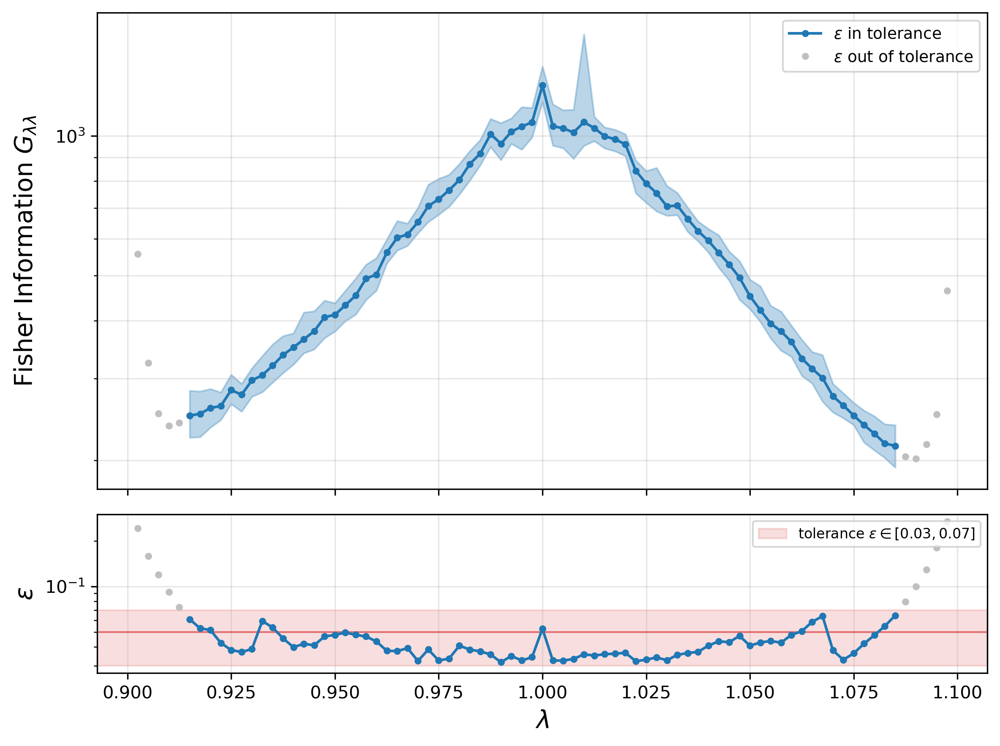
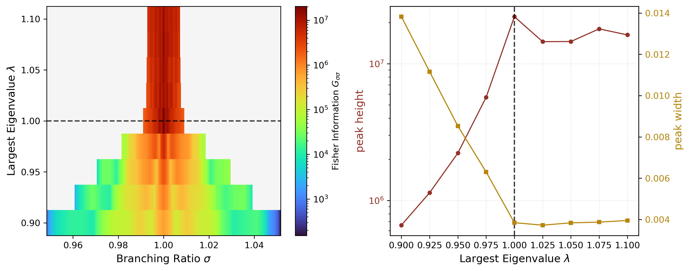

# Fisher information as a measure of proximity to criticality

[](https://arxiv.org/abs/2609.07624)
[](https://github.com/yuewei-du/Fisher_information_neural_criticality/actions/workflows/tests.yml)

This repository applies the Fisher Information Metric (FIM) to neural systems as a
model-free estimator of proximity to criticality, as described in
[Du et al. (2026)](https://arxiv.org/abs/2609.07624).

FIM measures the response of the observable distribution to parameter variations:

$$
G_{\theta\theta} = \int \frac{[\partial_\theta \, p(x \mid \theta)]^2}{p(x \mid \theta)} \, \mathrm{d}x
$$

and peaks at the critical point in finite-size systems, making it a continuous,
model-free readout of proximity to criticality. The estimator uses finite differences
on non-parametric density estimates and assumes no functional form for `p(x|θ)`.

Two pipelines are supported, corresponding to the two settings studied in the paper:

- **Pipeline A — known control parameter**: the control parameter (e.g. the largest
  eigenvalue `λ` of the connectivity matrix) is directly accessible. FIM is estimated
  from simulation data sampled across the parameter space.
- **Pipeline B — unknown control parameter**: the control parameter is not directly
  accessible, as in real neural recordings. FIM is instead estimated from a collective
  observable of interest. We use the time-dependent *observed* branching ratio
  `σ(t) = S(t+1)/S(t)`, where `S(t)` is a population-level signal (e.g. firing rate).
  The FIM $G_{\sigma\sigma}$ peak sharpens as the system approaches criticality, giving
  a model-free readout of proximity to criticality without knowledge of the true
  control parameter.

  Pipeline B therefore applies in principle to any neural data that yields a
  population-level time series: spike-train recordings, LFP, BOLD (fMRI), MEG, or EEG.

## Example

Both pipelines are demonstrated on a spiking neural network with a known critical
point at λ = 1, which serves as a ground truth for validating the FIM peak. For the
network definition and parameters, see the Methods section of
[Du et al. (2026)](https://arxiv.org/abs/2609.07624).

| Script | Reproduces |
|---|---|
| `examples/spiking_brain/run_pipeline_lambda.py` | Fig. 3a — FIM of the control parameter, $G_{\lambda\lambda}$ |
| `examples/spiking_brain/run_pipeline_sigma.py` | Fig. 3b — FIM of the observed branching ratio, $G_{\sigma\sigma}$ |

<p align="center">
  
</p>

<p align="center">
  
</p>

---

## Install and run

```bash
pip install -e ".[examples]"

# Pipeline A: FIM of the control parameter
python -m examples.spiking_brain.run_pipeline_lambda

# Pipeline B: FIM of the observed branching ratio
python -m examples.spiking_brain.run_pipeline_sigma
```

Run the example scripts from the repository root. To use only the estimator,
`pip install -e .` is enough; the `examples` extra adds `numba` for the
spiking network simulation. Python 3.10 or later is required.

Both scripts write their `.npz` files and figures to `outputs/`. Before running them,
note that:

- **They take hours.** At the settings used for the paper, the simulations alone
  take about 30 CPU-hours per pipeline (measured on an Intel i7-12700), i.e. roughly
  4–5 hours with the 7 worker processes the scripts use, followed by the FIM
  estimation. Both scripts re-run the simulation every time they are started. To try
  the pipelines quickly, reduce `n_trials`, `T` and the parameter grid in the
  configuration block at the top of each script.
- **They open figure windows.** Each script shows diagnostic and result figures
  (`plt.show()`), which pause the run until closed. Set `show_figures = False` in the
  configuration block to run unattended; the figures are still saved to `outputs/`.
- `n_jobs` (default 7) sets the number of worker processes; adjust it to your machine.

---

## Using the estimator on your own data

### Input

The FIM estimator expects a 2D array of shape `(n_samples, n_param_values)`, with
column `i` holding the samples of the observable at parameter value `param_values[i]`.
Columns with different numbers of samples can be passed as a list of 1D arrays instead.
The two pipelines differ only in how this input is constructed.

**Pipeline A** — scan the control parameter directly: run the simulation at each
parameter value $\theta_i$ and collect `n_samples` observations per point. The 2D array
is obtained directly; no preprocessing is needed.

**Pipeline B** — digitise a time series. Starting from a population activity time
series `S(t)`:

```text
S(t)  ->  σ(t) = S(t+1) / S(t)               (drop points where S(t) = 0)
      ->  bin the time points by their value of σ(t)
      ->  column i = the values of S(t) at the time points whose σ(t) falls in bin i
```

The bins play the role of the parameter grid: `param_values` are the bin centres, and
each column holds the samples of the activity `S` observed at that value of the
branching ratio. `digitize_into_bins_adaptive` chooses the narrowest uniform bin width
for which every bin around `σ = 1` holds at least `N_sim` samples, and returns the
per-bin samples, the bin centres and the bin width. The result is passed to
`compute_fim` exactly as in Pipeline A.

### Code

```python
import numpy as np
from fim import compute_fim, digitize_into_bins_adaptive, plot_histogram_and_pdf

# Pipeline B only: build the input from an activity time series S_t
valid = S_t[:-1] > 0
sigma_t = S_t[1:][valid] / S_t[:-1][valid]
data, param_values, bin_width = digitize_into_bins_adaptive(
    sigma_t, S_t[:-1][valid], N_sim=10000, center=1.0,
)

# Pipeline A: data has shape (n_samples, n_param_values), param_values (n_param_values,)

index_range = np.arange(1, len(param_values) - 1)

# Before estimating the FIM: check the histogram of the samples against the
# estimated PDF at a few parameter values
samples = list(data.T) if data.ndim == 2 else list(data)  # one array per value
for i in index_range[::10]:
    plot_histogram_and_pdf(
        [samples[i], samples[i - 1], samples[i + 1]],
        G=100, alpha=1, para=param_values[i], param_label=r"\theta",
    )

# Pipeline A: symmetric numerical derivative
FI_mean, FI_low, FI_up, eps = compute_fim(
    data, param_values, index_range,
    G=100, alpha=1, N_sim=10000, N_rep=32, n_jobs=-2, seed=0,
)

# Pipeline B: one-sided numerical derivatives, and the average of the two estimates
backward = compute_fim(
    data, param_values, index_range,
    G=100, alpha=1, N_sim=10000, N_rep=32, n_jobs=-2, seed=0,
    calc_method="sigma", direction="backward", logarithmic=True,
)
forward = compute_fim(
    data, param_values, index_range,
    G=100, alpha=1, N_sim=10000, N_rep=32, n_jobs=-2, seed=0,
    calc_method="sigma", direction="forward", logarithmic=True,
)
FI_mean = (backward[0] + forward[0]) / 2
```

### Output

All four outputs are arrays aligned with `index_range`:

- `FI_mean`: the mean of the FIM over the `N_rep` bootstrap resamples.
- `FI_low`, `FI_up`: the 5th and 95th percentiles over the resamples, i.e. a 90%
  bootstrap interval. They coincide with `FI_mean` when `N_rep=1`.
- `eps`: $\epsilon$, which quantifies the numerical accuracy of the FIM estimate at
  each parameter point. For every point the estimator searches for the
  finite-difference step $\Delta\theta$ that brings $\epsilon$ to its optimal value of
  about 0.05 (tolerance 0.03–0.07). Values outside this range mean no suitable step
  was found, typically near the edges of the parameter grid, and the corresponding
  FIM values should be treated with caution. For details of the estimation algorithm,
  see [npfi](https://doi.org/10.1103/PhysRevE.93.023301) by Har-Shemesh et al.

### Check the inputs first

Before running the FIM estimation, we recommend calling `plot_histogram_and_pdf` on a
few parameter values to validate the inputs. The function plots the histogram of the
samples, along with the PDF estimated by DEFT. This lets you verify two things:
(1) whether the sampling process has explored the full ensemble, so that the samples
adequately represent the underlying probability distribution; (2) whether the
estimated PDF fits the empirical histogram well, confirming that `G` and `alpha` are
appropriately chosen.

### Key arguments

| Argument | Default | Meaning |
|---|---|---|
| `G` | `100` | number of grid points (resolution) for PDF estimation in [npfi](https://doi.org/10.1103/PhysRevE.93.023301) |
| `alpha` | `1` | smoothness parameter in [npfi](https://doi.org/10.1103/PhysRevE.93.023301) |
| `N_sim` | `10000` | number of samples drawn per parameter value in each bootstrap resample and fed to [npfi](https://doi.org/10.1103/PhysRevE.93.023301) for non-parametric density estimation. Recommended minimum: 10000 |
| `N_rep` | `32` | number of bootstrap resamples |
| `calc_method` | `None` | `None` computes the numerical derivative symmetrically using `(θ−dt, θ, θ+dt)` (Pipeline A); `"sigma"` uses a one-sided derivative `(θ, θ+dt)` or `(θ, θ−dt)` — necessary when probability distributions at nearby parameter points differ substantially (Pipeline B). Any other value raises an error |
| `direction` | `"forward"` | which side to use for the one-sided numerical derivative: `"forward"` uses `(θ, θ+dt)`, `"backward"` uses `(θ, θ−dt)`; only used when `calc_method="sigma"` |
| `logarithmic` | `False` | `False` differentiates `p(x│θ)` directly and is generally more accurate, as discussed in [npfi](https://doi.org/10.1103/PhysRevE.93.023301); `True` differentiates `log p(x│θ)` instead, which can improve numerical stability when `p` is very small. Both example scripts use `True` |
| `n_jobs` | `-2` | number of worker processes for the bootstrap, as in joblib (`-2`: all cores but one) |
| `seed` | `None` | seed for the bootstrap resampling; the same seed gives the same result for any `n_jobs` |
| `verbose` | `False` | report the step search at every parameter point through Python's `logging` |

---

## Tests

```bash
pip install -e ".[test]"
pytest
```

The test suite checks the finite-difference schemes against distributions with known
Fisher information, the estimator end to end, the binning used by Pipeline B, and the
spiking network example. It takes about 20 seconds.

---

## Layout

```
fim/
  __init__.py    the public API
  estimator.py   FisherInfoCalculator, compute_fim, compute_fim_metrics
  digitize.py    adaptive binning of a (parameter, observable) cloud
  plotting.py    plot_histogram_and_pdf, plot_fim_heatmap
  npfi.py        non-parametric FI from finite differences  (adapted)
  deft.py        DEFT density estimation                    (adapted)

examples/spiking_brain/
  model.py                random network, compiled time evolution
  simulate.py             simulation drivers, including the branching ratio σ(t)
  run_pipeline_lambda.py  Pipeline A, end to end
  run_pipeline_sigma.py   Pipeline B, end to end

figures/
  pipeline_a.png          Fig. 3a, copy of the figure written by run_pipeline_lambda.py
  pipeline_b.png          Fig. 3b, copy of the figure written by run_pipeline_sigma.py

tests/                    pytest suite
pyproject.toml            package metadata and dependencies
```

`npfi.py` and `deft.py` are adapted from third-party sources, both MIT licensed; their
license notices are kept in the files:
- `npfi.py` [omrihar_npfi](https://github.com/omrihar/1_npfi) — Copyright (c) 2015 Omri Har-Shemesh. Ported to Python 3, and extended with the `direction` keyword and the one-sided (forward/backward) difference schemes used by Pipeline B.
- `deft.py` [Kinney_deft](https://github.com/jbkinney/13_deft) — Copyright (c) 2014 Justin B. Kinney. Ported to Python 3.

---

## Citation

If you use this code, please cite:

```bibtex
@article{du2026fisher,
  title={Fisher Information Metric as a model-free measure of proximity to criticality in neural systems},
  author={Du, Yuewei and Liardi, Alberto and Rajpal, Hardik and Jensen, Henrik Jeldtoft},
  journal={arXiv preprint arXiv:2609.07624},
  year={2026}
}
```
